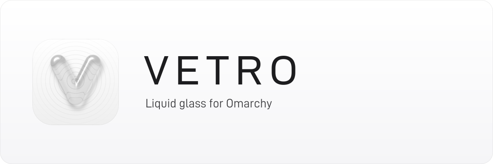
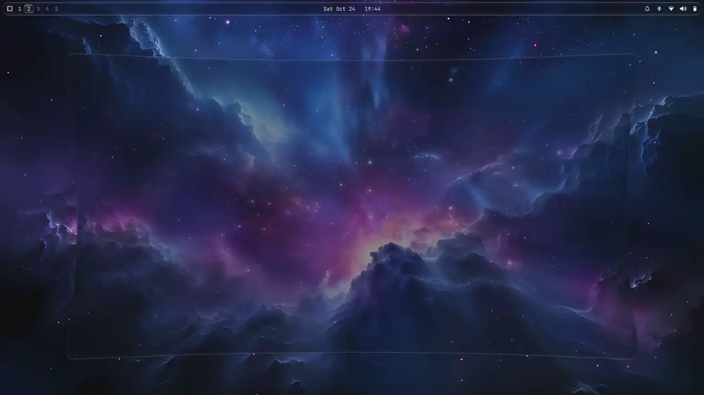

<p align="center">
  
</p>

# Vetro

**Real liquid glass for Omarchy: the bar, the menu, the panels, the notifications, the lock screen and your windows. Your theme stays yours.**

Omarchy's floating parts are flat see-through rectangles over a blur. Hyprland can blur what is behind a surface, but it cannot bend it: no refraction, no lit edge, nothing that reads as glass. Vetro is a Hyprland plugin and a set of Omarchy shell plugins that make them glass. Each pane bends the light at its edge, lights a rim that follows its own corners and frosts what is behind it, and windows move to match: a genie when they close, jelly when they open, a wobble when you drag them. It lies over your theme instead of replacing it, and `vetro off` gives you Omarchy back as it was.

<p align="center">
  
  <br>
  <a href="https://github.com/ParkerrDev/vetro/releases/latest/download/vetro.mp4">The whole video</a> (55 seconds, 1440p, with sound)
</p>

```bash
curl -fsSL https://raw.githubusercontent.com/ParkerrDev/vetro/master/install.sh | bash -s -- --on
```

> Omarchy 4 on Hyprland 0.56.2: the engine is built only for a Hyprland it has been seen working with. No root password. Rust is installed for you if it is missing.
> Run the same line again to update. `vetro off` takes the glass away; `~/.local/share/vetro/uninstall.sh` takes Vetro out.

---

<details>
<summary><b>What changes</b></summary>

<br>

| | |
|---|---|
| **Bar** | Omarchy's own bar, every widget of it, on a pane of glass. The workspace selector is a drop of glass that glides from number to number. |
| **Menu** | Omarchy's menu and app launcher on glass, over a frosted screen. |
| **Panels** | The calendar and the other panels the bar opens. |
| **Notifications** | Glass toasts, a notification centre and its bell, served by Vetro's own notification daemon. |
| **Volume** | The on-screen display. |
| **Lock screen** | Rounder, and glass over your wallpaper. |
| **Windows** | See-through windows (the terminal, for one) are glass too. Windows under glass show through it; the desktop's widgets never do. |
| **Motion** | One pace for windows, panels, menus and workspaces, and a genie, jelly and wobble to switch on in Vetro Glass. |
| **Vetro Glass** | An app to tune all of it by hand, with presets. |

Your theme, wallpaper and terminal colours stay the theme's. While Vetro is on, the shell's colours and the GTK, Qt and Kvantum ones are Vetro's own black and white.

</details>

---

<details>
<summary><b>How it works</b></summary>

<br>

### The engine

The glass is drawn by `hyprglass.so`, a Hyprland plugin: a fork of [hyprnux/hyprglass](https://github.com/hyprnux/hyprglass) kept in `engine/`, with its shading, tuning and motion in Rust (`engine/crates`) and its hooks into Hyprland in C++ (`engine/src`). Panes and windows get Apple's own glass shader, tuned as the Author's pick or as you leave it.

A plugin has to match its compositor exactly, so `engine/pins` says which engine commit is built for which Hyprland commit, and a pin is added only once that pair has been built and seen working. `engine/build.sh` reads the installed Hyprland's commit from its headers, builds the pinned engine at a low priority and moves it into `~/.local/lib/vetro`. After every `omarchy update` a hook builds it again if Hyprland changed, and never fails the update.

### What keeps it safe

- The engine is loaded from outside (`vetro glass load`), never by Hyprland's config. Hyprland reads its config again each time a plugin loads, so a config that loads one loops and freezes the screen.
- `hypr/vetro.lua` counts how often it is read. Past twelve readings in ten seconds it leaves the glass alone until `vetro on`.
- The glass is optional at every step. With no engine, an engine built for another Hyprland, or one that refuses its settings, every pane has plain blur and nothing errors.

### On and off

`vetro on` lays marked blocks and links in your home folder: a block in `~/.config/omarchy/shell.toml` that makes the bar see-through and gives the shell Vetro's colours, a see-through block for foot and kitty, the GTK, Qt and Kvantum colours, and the shell plugins in place of Omarchy's notifications, volume display, lock screen and menu. Then it reloads Hyprland, restarts the shell and loads the engine.

`vetro off` takes each of them away and gives Omarchy's own plugins back. It touches no theme, no wallpaper and no package. A file of yours in the way of a link is kept as `NAME.pre-vetro` and put back.

Omarchy's shell reads `~/.config/omarchy/shell.toml` over the theme's own, key by key. That is how Vetro's colours win over any theme and outlast a change of theme without being part of it.

</details>

---

<details>
<summary><b>Installation</b></summary>

<br>

### One line

```bash
curl -fsSL https://raw.githubusercontent.com/ParkerrDev/vetro/master/install.sh | bash -s -- --on
```

It:

1. clones Vetro into `~/.local/share/vetro`, or updates the copy there;
2. installs Rust with Omarchy's `omarchy-install-dev-env rust` if `cargo` is missing;
3. links the command, the Lua file, the shell plugins, the hooks and the fonts into your home folder, and adds one marked line to the end of `~/.config/hypr/hyprland.lua`;
4. builds the glass engine, the notification daemon and the launch cards' daemon;
5. with `--on`, switches it on. Without it nothing changes on screen until `vetro on`.

### By hand

```bash
git clone https://github.com/ParkerrDev/vetro ~/.local/share/vetro
~/.local/share/vetro/install.sh
vetro on
```

| Flag | |
|---|---|
| `--on` | switch it on when done |
| `--no-build` | link everything and build nothing yet; the panes have plain blur until `install.sh` runs again |
| `--without launch` | leave the launch cards out (`--without theme`: the launch theme) |

Everything lands as a symlink into the clone, and running `install.sh` again changes nothing that is already in place. The settings in `~/.config/vetro/` are copied once and are yours.

### Looks best with

`papirus-icon-theme`, `adw-gtk-theme`, `kvantum`, `qt6ct-kde`, `xcursor-pro-cursor-theme` and `xcursor-pro-hyprcursor`. Vetro does not install them; `vetro doctor` says which are missing.

### Uninstall

```bash
~/.local/share/vetro/uninstall.sh            # --purge: the built engine and the saved state too
```

</details>

---

<details>
<summary><b>Commands</b></summary>

<br>

```
vetro on                 lay the glass and Vetro's colours over your theme
vetro off                take them away: Omarchy as it ships, your theme untouched
vetro toggle             whichever it is not (bind a key to this one)
vetro status             on or off, the engine, the guard
vetro tune               open Vetro Glass
vetro glass look [NAME]  which glass it is, or another (see Tuning the glass)
vetro glass load         the engine into the running Hyprland (on and login do this)
vetro glass unload       the engine out of it
vetro build [--force]    build the engine for the Hyprland that is installed
vetro doctor             check the installation, one line a check
```

</details>

---

<details>
<summary><b>Tuning the glass</b></summary>

<br>

Open **Vetro Glass** from the app launcher (the glass V), or run `vetro tune`. Its sliders cover how clear or tinted the glass is, the frost, colour and inner light, how much darker it gets over bright things, the lens with its bend and colour fringe, the darkened edge, where the light comes from, the rim, the hairline and the glow, whether windows show through, and the motion. The presets set all of them at once: **Author's pick** (the default), iOS 27, Ultra clear, Clear, Tinted, Fully tinted, iOS 26 and Lens.

Every change is written to `~/.config/vetro/glass.conf`, plain `key = value` lines, and drawn at once. After editing the file by hand run `hyprctl hyprglass tune reload`; to try values without writing them, `hyprctl hyprglass tune frost=12 tint=0.4`.

Earlier looks are one command away: `vetro glass look lens`, `macos`, `liquid`, `regular`, `cloud`, `clear` or `sharp`. `vetro glass look apple` comes back to the tuned glass.

### Motion

Also in Vetro Glass, and in the same file:

| Key | Default | |
|---|---|---|
| `pace` | `1` | how quickly windows, panels, menus and workspaces move, `0.5` to `2` |
| `genie_close` | `0` | a closing window pours itself into the bottom of the screen |
| `genie_open` | `0` | a new window pours out of it |
| `genie_pointer` | `0` | the genie pours toward the pointer instead |
| `genie_time` | `0.55` | seconds |
| `jelly` | `0` | a new window lands with a soft squash and settles |
| `jelly_squash` | `0.08` | how far it squashes |
| `wobble` | `0` | a dragged window bends behind the pointer and jiggles as it settles |
| `wobble_moves` | `0` | windows the layout moves wobble too |
| `wobble_time` | `0.55` | seconds to settle |
| `wobble_bounce` | `0.55` | how far it swings past where it rests |

</details>

---

<details>
<summary><b>Addons</b></summary>

<br>

Each addon in `addons/` is found at run time, and `vetro on` and `off` ask each installed one to follow.

- **launch**: two glass cards on the desktop, the next SpaceX launches and the weather, kept fresh by a small Rust daemon that sleeps until a fetch is due. The lock screen shows the next launch too. See `addons/launch/README.md`.
- **theme**: the launch look as an Omarchy theme, `launch`, in the theme menu like any other.
- **login**: the login screen in the same style. It needs root, so `install.sh` leaves it alone: `addons/login/install-system.sh`.

</details>

---

<details>
<summary><b>Project layout</b></summary>

<br>

```
bin/vetro            the command
lib/                 what it and the installers share: on, off, doctor
hypr/vetro.lua       the one Lua file Hyprland loads: blur, which panes get glass,
                     the corners, and the guard against a config read in a loop
engine/              the glass engine and what builds it (build.sh, pins, post-update.sh)
shell/               the shell plugins, their library (vetro.lib), the notification
                     daemon (notifyd, Rust), the fonts and the shell's settings
apps/glass/          Vetro Glass, the tuning app (GTK 4)
override/            the colours laid over any theme: shell, terminals, GTK, Qt, Kvantum
addons/              launch, theme, login
assets/branding/     the glass V and the banner, rendered by render.py
tools/               bar-build.py, which builds Vetro's bar from Omarchy's own
install.sh           link everything and build; uninstall.sh takes it all out
tests/, scripts/     the checks
```

</details>

---

<details>
<summary><b>Development</b></summary>

<br>

```bash
scripts/check-repo                       # shellcheck, Lua, Python, data files, and every
                                         # script tested against stand-ins (no desktop touched)
VETRO_TEST_ENGINE=1 scripts/check-repo   # and the engine's and the daemons' own tests
scripts/check-text                       # no em-dash or en-dash, no credit to an AI assistant
git config core.hooksPath .githooks      # the same checks on every commit
```

The tests hold the structure, not the look: nothing checks pixels. A change to the engine needs a new line in `engine/pins`, added once that engine has been seen working on that Hyprland.

Found a bug? Open an issue with what `vetro doctor` prints.

</details>

---

<details>
<summary><b>Limits</b></summary>

<br>

- **One Hyprland at a time.** Each new Hyprland needs a pin. Until it has one, the panes have plain blur.
- **Dark only.** There is no light glass.
- **Fixed toolkit colours.** GTK, Qt and Kvantum are Vetro's black and white while it is on, not drawn from the wallpaper.

</details>

---

<details>
<summary><b>Credits and license</b></summary>

<br>

Vetro is MIT (`LICENSE`). It stands on:

- [hyprglass](https://github.com/hyprnux/hyprglass) by Hyprnux, the engine it forks (BSD 3-Clause, `engine/LICENSE`);
- [HyprPerks' Hyprland Desktop Experience](https://github.com/hyprwm/hyprperks-dotfiles), where Vetro's shell began, released under MIT by Hyprland Development thanks to Omarchy's Omacom Foundation sponsorship;
- [Omarchy](https://github.com/basecamp/omarchy), whose menu, workspace and lock plugins Vetro's are cloned from (MIT);
- D-DIN by Datto and Nunito (SIL OFL 1.1), Material Symbols by Google (Apache 2.0), and KvLibadwaita by Gabriel Perko-Engel for Kvantum (GPL 3.0);
- "Machines With Feelings" by HoliznaCC0 (CC0), the music in the video.

`NOTICE` says which file is under which terms.

</details>
