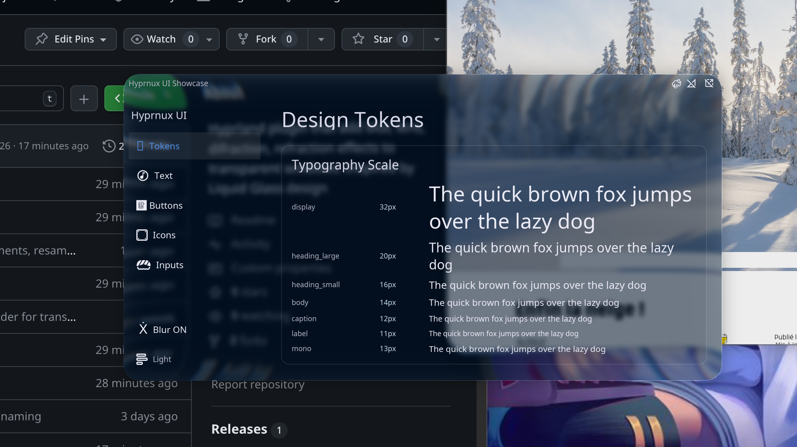

# HyprGlass - Liquid Glass inspired plugin for Hyprland

Liquid Glass for [Hyprland](https://hyprland.org/).

Frosted blur, edge refraction, chromatic aberration, specular highlights — fully customizable, per-theme, on every window and layer surface.

| Dark | Light |
|:---:|:---:|
|  |  |

## Installation

### hyprpm (recommended)

Builds against your exact Hyprland version, no ABI mismatch headaches:

```bash
hyprpm add https://github.com/hyprnux/hyprglass
hyprpm enable hyprglass
```

On a Hyprland release, hyprpm installs the hyprglass release made for it. On hyprland-git, it builds `main`, which follows Hyprland's development branch.

If your distribution's Hyprland isn't recognized as a release and the build fails, use the stable branch of your Hyprland version:

```bash
hyprpm remove https://github.com/hyprnux/hyprglass
hyprpm add https://github.com/hyprnux/hyprglass origin/hyprland-0.56
hyprpm enable hyprglass
```

hyprpm then stays on that branch through `hyprpm update`. Repeat this with the new branch when you upgrade Hyprland to its next minor version.

### Pre-built release

Grab `hyprglass.so` from [Releases](https://github.com/hyprnux/hyprglass/releases/latest). Each release targets a specific Hyprland API version — check the release notes to confirm it matches yours. If it doesn't match, hyprglass stays paused instead of crashing Hyprland (see [Troubleshooting](#troubleshooting)).

```bash
hyprctl plugin load /path/to/hyprglass.so
```

Or persist it in your config:

```ini
plugin = /path/to/hyprglass.so
```

### Manual build

```bash
git clone https://github.com/hyprnux/hyprglass && cd hyprglass
git checkout hyprland-0.56   # branch of your Hyprland version; stay on main for hyprland-git
make
hyprctl plugin load $(pwd)/hyprglass.so
```

What the build needs, beyond Hyprland's own headers (the `hyprland` package), `pixman`, `libdrm`, `pkgconf` and a C++23 compiler (`base-devel`):
**Rust**, which is the `rust` package on Arch and Omarchy (cargo and rustc 1.85 or newer, with nothing else installed). The glass model is a Rust crate that `make` builds with `cargo build --release --locked` and links into the plugin as a static library; `panic = "abort"` is set in the release profile, so nothing can unwind into the compositor. The first build fetches the model's two small dependencies, pinned by `Cargo.lock`, from crates.io; fetch them beforehand with `cargo fetch --locked` to build offline. `hyprpm` runs the same `make`, so it needs `rust` too.

`make test` runs the model's tests, checks the committed C header against the Rust source and the C and C++ compilers, and compiles every shader. `make check` adds formatting, clippy with every warning an error, the documentation build and `cargo deny`.

## Configuration

### Lua config

The plugin must be loaded before configuring it. Wrap everything in a guard:

```lua
if hl.plugin.hyprglass then
    local hg = hl.plugin.hyprglass

    hg.config({
        default_theme = "dark",
        default_preset = "clear",
        tint_color = 0x8899aa22,

        brightness = 0.9,
        dark = { brightness = 0.82 },
        light = { adaptive_boost = 0.5 },

        layers = { enabled = true },
    })

    -- Layer surfaces: each call whitelists the namespace and configures it
    hg.layer("waybar", { preset = "subtle", mask_threshold = 0.05 })
    hg.layer("swaync")
    hg.layer("quickshell:bezel", { preset = "ui", mask_threshold = 0.3 })
    hg.layer("debug-panel", { exclude = true })

    -- Presets
    hg.preset("clear", {
        glass_opacity = 0.8,
        blur_strength = 1.5,
        dark = { brightness = 0.7 },
        light = { brightness = 1.2 },
    })

    hg.preset("contrasted", {
        inherits = "high_contrast",
        contrast = 1.2,
        adaptive_dim = 1.5,
        dark = { tint_color = 0x02142aa9 },
    })
end
```

**Checking the config**

```sh
hyprctl configerrors                                # unknown options, with the file and line of the hg.config call
hyprctl getoption plugin:hyprglass:layers:enabled   # "set: true" once your value is applied
```

### Legacy .conf config

_Deprecated as of Hyprland 0.55, but still supported._

```ini
plugin:hyprglass {
    default_theme = dark
    default_preset = clear
    tint_color = 0x8899aa22

    brightness = 0.9
    dark:brightness = 0.82
    light:adaptive_boost = 0.5

    preset = name:clear, glass_opacity:0.8, blur_strength:1.5
    preset = name:clear:dark, brightness:0.7
    preset = name:clear:light, brightness:1.2

    preset = name:contrasted, inherits:high_contrast, contrast:1.2, adaptive_dim:1.5
    preset = name:contrasted:dark, tint_color:0x02142aa9

    layers {
        enabled = 1
        namespaces = waybar, swaync, quickshell:bezel
        exclude_namespaces = debug-panel
        preset = subtle
        namespace_presets = quickshell:bezel:ui
        namespace_mask_thresholds = waybar=0.05, quickshell:bezel=0.3
    }
}
```

### Global settings

| Option | Type | Default | Description |
|---|---|---|---|
| `enabled` | bool | `true` (`1` in .conf) | Enable/disable the effect globally. Per-window tags override this. |
| `manage_window_blur` | bool | `true` (`1` in .conf) | Automatically set the `noblur` property on glassed windows. Glass replaces Hyprland's blur; without `noblur`, Hyprland's cached-blur optimization (`blur:new_optimizations`) hides the glass on static windows. Set to `0` to manage `windowrule = noblur` yourself. |
| `skip_opaque_windows` | bool | `true` (`1` in .conf) | Skip glass under an opaque window — it would be invisible anyway, so skipping it saves GPU. Set to `0` to force glass everywhere. Windows using `self_sample` are never skipped, since their glass shows their own content. |
| `blur_fold` | bool | `true` (`1` in .conf) | Fewer blur passes with an identical look. Set to `0` to always run `blur_iterations` passes at the configured radius. |
| `default_theme` | string | `dark` | Default theme: `dark` or `light` |
| `default_preset` | string | `default` | Default preset name |

### Overridable settings

Set globally, per theme (`dark:` / `light:` prefix in .conf, or `dark = {}` / `light = {}` table in Lua), or in a preset.

Settings resolve through: **preset chain** (theme variant, shared, inherited) then **theme override** then **global value** then **hardcoded default**.

| Option | Type | Global Default | Dark Default | Light Default | Description |
|---|---|---|---|---|---|
| `blur_strength` | float | `2.0` | — | — | Blur radius scale (`value * 12.0` px) |
| `blur_iterations` | int | `3` | — | — | Gaussian blur passes (1-5) |
| `noise_strength` | float | `0.0` | — | — | Frosted grain over the glass, see [Frosted grain](#frosted-grain) (0.0-1.0) |
| `refraction_strength` | float | `0.6` | — | — | Edge refraction intensity (0.0-1.0) |
| `refraction_flow` | float | `0.0` | — | — | Where the edge distortion pulls: 0 toward the window center, 1 along the edges (0.0-1.0) |
| `refraction_spread` | float | `1.0` | — | — | How deep the distortion reaches: 1 across the whole window, 0 only a rim with a flat center (0.0-1.0) |
| `chromatic_aberration` | float | `0.5` | — | — | Spectral dispersion at edges (0.0-1.0) |
| `fresnel_strength` | float | `0.6` | — | — | Edge glow intensity (0.0-1.0) |
| `fresnel_tint` | float | `0.0` | — | — | Color of the edge glow: 0 white, 1 the colors behind the glass (0.0-1.0) |
| `fresnel_color` | color | `0xffffff00` | — | — | Color of the edge glow; alpha sets how much it replaces white (0xRRGGBBAA) |
| `specular_strength` | float | `0.8` | — | — | Specular highlight brightness (0.0-1.0) |
| `specular_angle` | float | `0.0` | — | — | Where the specular highlight comes from, in degrees: 0 from the top, 90 from the right, clockwise |
| `bevel_strength` | float | `0.0` | — | — | Thin lit line along the glass edge, a nicer border (0.0-1.0) |
| `bevel_size` | float | `6.0` | — | — | Width of the bevel line in logical pixels, uniform across monitor scales |
| `bevel_color` | color | `0xffffff00` | — | — | Color of the bevel line; alpha sets how much it replaces white, dark colors give a dark line (0xRRGGBBAA) |
| `bevel_tint` | float | `0.0` | — | — | Tint of the bevel line: 0 its own color, 1 the colors behind the glass (0.0-1.0) |
| `bevel_angle` | float | `315.0` | — | — | Where the bevel light comes from, in degrees: 0 from the top, 90 from the right, clockwise |
| `bevel_shadow` | float | `0.0` | — | — | Darkening of the bevel line on the side away from the light (0.0-1.0) |
| `glass_opacity` | float | `1.0` | — | — | Overall glass opacity (0.0-1.0) |
| `edge_thickness` | float | `0.06` | — | — | Bezel width, fraction of smallest dimension (0.0-0.15) |
| `tint_color` | color | `0x8899aa22` | — | — | Glass tint RRGGBBAA hex. Alpha = tint strength |
| `lens_distortion` | float | `0.5` | — | — | Center dome magnification (0.0-1.0) |
| `self_sample` | float | `0.0` | — | — | Mixes the window's own content into the glass behind it (0.0-1.0). Windows only |
| `xray` | int | `0` | — | — | `1` hides the windows under the glass: only the wallpaper shows through. See [X-ray](#x-ray) |
| `brightness` | float | — | `0.82` | `1.12` | Brightness multiplier |
| `contrast` | float | — | `0.90` | `0.92` | Contrast around midpoint |
| `saturation` | float | — | `0.80` | `0.85` | Desaturation (0 = grayscale, 1 = full) |
| `vibrancy` | float | — | `0.15` | `0.12` | Selective saturation boost |
| `vibrancy_darkness` | float | — | `0.0` | `0.0` | Holds vibrancy back in dark areas: 0 boosts everywhere, 1 leaves black untouched, above 1 desaturates dark areas |
| `adaptive_dim` | float | — | `0.4` | `0.0` | Dims bright areas behind the glass (0 leaves white white). Above about 0.36 the dim would make white darker than grey; past that point bright areas are held at the level the curve reached, so nothing brighter behind ever comes out darker |
| `adaptive_boost` | float | — | `0.0` | `0.4` | Boosts dark areas behind the glass (black is black 0 -to- 1 black becomes white) |

`—` in Global Default = falls through to per-theme default. `—` in Dark/Light = inherits global value.

Ranges in parentheses are the usual span, not limits: only `blur_iterations` and `self_sample` are clamped, and the built-in presets go past some of them (`glass` uses `refraction_strength = 8.0`).

#### Self sampling

`self_sample` needs a translucent window: its content is composited over the sampled desktop.

- At `1.0` the pane shows the window's own pixels. Where the client draws translucent ones (terminal transparency), the desktop still shows through
- A window made see-through by `windowrule = opacity` draws opaque pixels, so its pane is entirely its own content
- Raise `blur_strength` with it, or the window's own text stays readable in its glass
- A window showing the screen (screen-share preview, OBS) sees a one-frame-old copy of itself
- Transformed monitors (rotated or flipped) and layer surfaces ignore it

**Cost:** a self-sampling window re-blurs its whole pane whenever its content changes, so busy windows cost more than static ones.

**On the fly:**
```bash
hyprctl keyword plugin:hyprglass:self_sample 1.0
```

**Lua:**
```lua
hg.config({ self_sample = 0.6 })
hg.preset("aura", { inherits = "glass", self_sample = 1.0, blur_strength = 2.5 })
```

**Legacy .conf:**
```ini
self_sample = 0.6
preset = name:aura, inherits:glass, self_sample:1.0, blur_strength:2.5
```

#### X-ray

With `xray = 1` the glass shows the wallpaper and nothing else: never the windows under it, nor the bottom layer (a desktop's widgets), however light the blur. Same idea as Hyprland's `decoration:blur:xray`. It is also the cheapest glass there is: it reads the monitor's *backdrop*, the background layers drawn by the engine into one texture with a mip chain, which is drawn again only when a background layer commits, moves or fades. A window that moves, or a clock that ticks behind it, needs no new copy of the screen, and every x-ray pane on the monitor shares the one texture. Turn it on everywhere, or only where a preset applies:

**On the fly:**
```bash
hyprctl keyword plugin:hyprglass:xray 1
```

**Lua:**
```lua
hg.config({ xray = true })                                   -- every glass
hg.preset("pane", { inherits = "glass", xray = true })       -- or only this preset
hl.window_rule({ match = { class = "foot" }, tag = "+hyprglass_preset_pane" })
hg.layer("waybar", { preset = "pane" })
```

**Legacy .conf:**
```ini
xray = 1
preset = name:pane, inherits:glass, xray:1
windowrule = tag +hyprglass_preset_pane, class:foot
layers:namespace_presets = waybar:pane
```

- Background layers never use it: they are the wallpaper. Bottom layers may, since nothing lies between them and the wallpaper
- No effect with `render:xp_mode`, which draws no wallpaper, nor on a rotated output
- Layer glass samples the live frame while the session is locked
- Glass over a fullscreen window or on a special workspace shows the wallpaper without the fullscreen window or the special workspace dim
- Subsurface item glass ignores it

**Cost:** one monitor-sized texture with its mip chain per monitor showing x-ray glass (a third more than the frame, twice that with HDR), and in place of it no texture per window or pane. It is freed once the monitor has drawn 600 frames with no x-ray glass on it (about 10 s of activity at 60 Hz). `xray_copy` in `hyprctl hyprglass stats` counts the times it was drawn.

#### Frosted grain

`noise_strength` adds a fine, still grain to the glass so the blur reads as frosted glass: `0` none, `1` strong. `0.12` is about as strong as Hyprland's default `decoration:blur:noise`.

**On the fly:**
```bash
hyprctl keyword plugin:hyprglass:noise_strength 0.3
```

**Lua:**
```lua
hg.config({ noise_strength = 0.3, light = { noise_strength = 0.15 } })
hg.preset("frosted", { inherits = "subtle", noise_strength = 0.5 })
```

**Legacy .conf:**
```ini
noise_strength = 0.3
light:noise_strength = 0.15
preset = name:frosted, inherits:subtle, noise_strength:0.5
```

- The built-in `clear` preset turns the grain off, as it does the blur

### Layer surfaces

The glass effect can be applied to layer surfaces (bars, docks, widgets). **Disabled by default.**

Where the glass goes on a layer:
- Apps that request blur through the `ext-background-effect-v1` Wayland protocol get glass exactly where they ask for it
- Other layers get glass wherever their content is visible (alpha above `mask_threshold`), so partially transparent content (down to ~0.004 opacity) **triggers** the glass effect

`mask_mode` forces one behaviour: `auto` (default), `region` (only where the app requests blur; other layers get no glass) or `alpha` (visible content only).

**Caveat:** Layer shadows count as visible content. Use `mask_threshold` to set an alpha cutoff higher than your shadow opacity. Set it once for every layer with `layers:mask_threshold`; a per-layer value wins.

**Soft edges:** `mask_feather` fades the glass in over that much alpha above `mask_threshold`, so antialiased rounded corners blend instead of stepping. Content fainter than `mask_threshold + mask_feather` then gets lighter glass: keep `0` (default) for near-transparent bars. Only applies where glass follows visible content, not to the region an app requests.

#### Lua config

```lua
hg.config({ layers = { enabled = true } })
-- hg.config({ layers = { mask_threshold = 0.05 } })  -- cutoff for every layer (hides shadows fainter than 5%)

-- Each call whitelists the namespace and optionally configures it
hg.layer("waybar", { preset = "subtle", mask_threshold = 0.05, live_resample = false })
hg.layer("swaync")
hg.layer("quickshell:bezel", { preset = "ui", mask_threshold = 0.3 })
hg.layer("quickshell:bar", { mask_mode = "region" })
hg.layer("dock", { mask_feather = 0.45 })
hg.layer("debug-panel", { exclude = true })
```

| Field | Type | Description |
|---|---|---|
| `preset` | string | Preset override for this layer |
| `mask_threshold` | float | Per-layer override of `layers:mask_threshold` |
| `live_resample` | bool | Per-layer override of `layers:live_resample` |
| `mask_mode` | string | `"auto"`, `"region"` or `"alpha"`. See `layers:mask_mode` |
| `mask_feather` | float | Per-layer override of `layers:mask_feather` |
| `exclude` | bool | Blacklist this namespace instead of whitelisting it |

#### Legacy .conf config

| Option | Type | Default | Description |
|---|---|---|---|
| `layers:enabled` | bool | `false` (`0` in .conf) | Enable glass on layer surfaces |
| `layers:namespaces` | string | `""` | Comma-separated namespace whitelist. Empty = all layers |
| `layers:exclude_namespaces` | string | `""` | Comma-separated namespace blacklist (priority over whitelist) |
| `layers:preset` | string | `""` | Preset override for all layers |
| `layers:namespace_presets` | string | `""` | Per-namespace preset (`ns:preset` pairs, comma-separated) |
| `layers:mask_threshold` | float | `0.001` | Alpha threshold for all layers: pixels below it get no glass. Per-namespace values win |
| `layers:namespace_mask_thresholds` | string | `""` | Per-namespace alpha threshold (`ns=value` pairs, comma-separated) |
| `layers:namespace_live_resample` | string | `""` | Per-namespace live resample override (`ns=0/1` pairs, comma-separated) |
| `layers:live_resample` | bool | `true` (`1` in .conf) | Re-render layer glass when content behind it changes (e.g. a playing video). GPU cost scales with background activity; static scenes stay free. Overridable per layer |
| `layers:live_resample_fps` | int | `30` | Max re-renders per second per layer for live resample. `0` = uncapped |
| `layers:force_live_resample` | bool | `false` (`0` in .conf) | Experimental: re-render layer glass every frame regardless of changes, ignoring `live_resample_fps`. Heavy GPU/battery cost |
| `layers:mask_mode` | string | `auto` | Where the glass goes: `auto` = where the app requests blur, else where content is visible; `region` = only where the app requests blur; `alpha` = only where content is visible |
| `layers:namespace_mask_modes` | string | `""` | Per-namespace `mask_mode` (`ns=mode` pairs, comma-separated) |
| `layers:mask_feather` | float | `0` | Soft edges: glass fades in over this much alpha above `mask_threshold` (e.g. `0.45` for a rounded dock). `0` = hard edge. Ignored where the app requests a blur region |
| `layers:namespace_mask_feathers` | string | `""` | Per-namespace `mask_feather` (`ns=value` pairs, comma-separated) |
| `layers:manage_blur` | bool | `true` (`1` in .conf) | Replace Hyprland's own blur with glass on glassed layers (`layerrule = ignorealpha` then has no effect, use `mask_threshold`). Set to `0` to keep Hyprland's blur |

> Layer support hooks into Hyprland's internal render pipeline. This is version-sensitive and may break across Hyprland updates.

### Subsurface item glass

Glass a `wl_subsurface` of a window (a toolbar capsule, a round button) instead of the whole window: the client attaches `ext-background-effect-v1` to that subsurface, and glass is drawn exactly in its requested region.

| Option | Type | Default | Description |
|---|---|---|---|
| `subsurfaces:enabled` | bool | `false` (`0` in .conf) | Enable glass on subsurfaces that request it |
| `subsurfaces:preset` | string | `""` | Preset override for all items. Falls back to `layers:preset`, then `default_preset` |
| `subsurfaces:radius` | float | `-1` | Corner radius in logical px. `-1` (default) = capsule (fully rounded) |

**Lua:**
```lua
hg.config({ subsurfaces = { enabled = true, preset = "subtle", radius = 12 } })
```

**Legacy .conf:**
```ini
plugin {
    hyprglass {
        subsurfaces {
            enabled = 1
            preset = subtle
            radius = 12
        }
    }
}
```

A client app can hint its own preset and shape per item via the `hyprglass_item_v1` Wayland protocol (`protocols/hyprglass-item-v1.xml`), overriding the config above for that one item:

- `set_preset` / `unset_preset` — request a named preset for this item, or clear the hint
- `set_shape` — clip the effect to an explicit rect with up to four independent corner radii, in the item's own local coordinates
- `set_inherit_shape` — shape the item like its parent window instead: same corners, same rounding curve
- `unset_shape` — clear the shape hint

An item that sends no hints, or a preset name the compositor doesn't recognize, gets `subsurfaces:radius`'s capsule/rounded-rect shape over its blur region and the preset chain above.

### Window background cache

Windows cache their sampled, blurred background and only re-sample it when something actually changed behind the window (it moved/resized, the window behind it changed, or the cache was just allocated) — the same idea as the layer `live_resample` cache above, always on.

| Option | Type | Default | Description |
|---|---|---|---|
| `windows:background_cache` | bool | `true` (`1` in .conf) | Reuse a window's last sampled+blurred background instead of re-sampling it every frame. Set to `0` to always re-sample (pre-cache behavior). |
| `windows:live_resample` | bool | `true` (`1` in .conf) | Re-render window glass when content behind it changes (e.g. a playing video, another window). GPU cost scales with background activity; static scenes stay free |
| `windows:live_resample_fps` | int | `30` | Max background-dirty marks per second for windows. `0` = uncapped |
| `windows:border` | bool | `false` (`0` in .conf) | The window's border is glass. A window's pane reaches as far beyond the window as Hyprland's border is wide (`general:border_size`, or the window's own from a rule), so the band the border takes shows glass; a solid window, which gets no pane, is given that band alone, as a frame drawn in four strips at a quarter of the resolution. Works with `enabled = false` too: frames and no panes. Set `general:col.active_border` and `inactive_border` clear with it, or Hyprland draws its colours over the glass |
| `windows:border_dim` | float | `1.0` | How strongly the rim of a window without the focus is lit, as a share of the focused window's (0.0-1.0). With the border made of glass this is how the focused window is told from the others |

> `hyprctl hyprglass stats` reports `win_hit`/`win_miss`/`win_defer`/`win_disc` (and `layer_hit`/`layer_miss`/`layer_defer` for layers, `sub_hit`/`sub_miss`/`sub_defer` for subsurface items) per monitor to watch the cache in action.

### Per-window overrides

Control the effect, theme, and preset per window via tags.

#### Enable / disable

Override the global `enabled` setting per window via tags:

- `hyprglass_disabled` — force the effect off on this window (wins over `hyprglass_enabled` if both present).
- `hyprglass_enabled` — force the effect on this window. Useful with global `enabled = false` for a whitelist.

#### Theme

Each window's theme is resolved as:
1. **Window tag** `hyprglass_theme_light` or `hyprglass_theme_dark`
2. **Fallback** to `default_theme`

#### Preset

Assign via window rules:
- `hyprglass_preset_<name>` — override `default_preset` for this window

#### Examples

**Lua:**
```lua
hl.window_rule({ match = { class = "mpv" },       tag = "+hyprglass_disabled" })
hl.window_rule({ match = { fullscreen = true },    tag = "+hyprglass_disabled" })
hl.window_rule({ match = { class = "firefox" },    tag = "+hyprglass_theme_light" })
hl.window_rule({ match = { class = "myterminal" }, tag = "+hyprglass_preset_high_contrast" })
```

**Legacy .conf:**
```ini
windowrule = tag +hyprglass_disabled, class:mpv
windowrule = tag +hyprglass_disabled, fullscreen:1
windowrule = tag +hyprglass_theme_light, class:firefox
windowrule = tag +hyprglass_preset_high_contrast, class:myterminal
```

**On the fly:**
```bash
hyprctl dispatch tagwindow +hyprglass_disabled
hyprctl dispatch tagwindow +hyprglass_theme_dark
hyprctl dispatch tagwindow +hyprglass_preset_subtle
```

### Presets

Presets are named config overrides. They can be **built-in** or **user-defined**. User presets with the same name override built-in ones.

Each preset can have shared values (theme-agnostic), a dark variant, a light variant, and can inherit from another preset.

#### Built-in presets (Open to PR)

Always available. Activate via `default_preset` or per-window tags.

| Preset | Description |
|---|---|
| `high_contrast` | Punchy colors, strong tinting, good contrast between dark and light themes. Lower blur, stronger refraction. |
| `subtle` | Minimal glass effect. Light blur, reduced refraction and highlights. |
| `regular` | The default. Apple's regular Liquid Glass from measured numbers: frosted, toned and tinted so that text on it stays readable. Layers get the lens model described below. |
| `clear` | Apple's clear Liquid Glass, for panes over photos and video only: little frost, a dimming tint over bright content. Layers get the lens model. |
| `classic_clear` | Upstream's `clear`: minimal transparent effect, like a transparent rounded border glass plate. |
| `glass` | Solid glass block effect with a lot of chromatic aberration. |
| `pomme` | Apple look-alike liquid glass, keep in mind it's an approximation, and apple does not apply it on big window with square corners on purpose (open to PR). |

**Note:** These presets are starting points. Submit improvements or your own presets through issues or PRs (with screenshots).

#### User-defined presets

**Lua (table syntax):**
```lua
hg.preset("clear", {
    glass_opacity = 0.8,
    blur_strength = 1.5,
    inherits = "subtle",
    dark = { brightness = 0.7 },
    light = { brightness = 1.2 },
})
```

**Lua (string syntax, backward compat):**
```lua
hg.preset("name:clear, glass_opacity:0.8, blur_strength:1.5")
hg.preset("name:clear:dark, brightness:0.7")
```

**Legacy .conf:**
```ini
preset = name:clear, glass_opacity:0.8, blur_strength:1.5
preset = name:clear:dark, brightness:0.7
preset = name:clear:light, brightness:1.2
preset = name:contrasted, inherits:high_contrast, contrast:1.2
```

*Tip: increase the last two hex digits of `tint_color` for more tint opacity.*

## Liquid Glass model (branch `meniscus`)

Layer surfaces whose preset sets `model = 1` are drawn with a model of Apple's
Liquid Glass instead of the shader described under How It Works.
[docs/model.md](docs/model.md) has the equations, the source of every number,
and the comparison with an independent reference page
([docs/compare](docs/compare)).

What it does that the stock path cannot:

- Every connected part of a layer whose alpha reaches `mask_threshold` is a
  pane of its own. A card, a menu or a capsule inside one full-screen
  transparent layer gets its own rim, lens, frost, light and shadow along its
  own outline, with the rounded or squircle corners the client drew. No radius
  has to be declared.
- A dim the layer draws behind its cards is not glass, as long as
  `mask_threshold` lies between the dim's alpha and the card's.
- The glass ends as smoothly as the layer's own edge at any fractional scale,
  because the share of a pixel that is glass is read from the layer's own
  antialiasing.
- Nothing is sampled or drawn while nothing behind a pane changes, and a
  change behind one pane resamples that pane only.

### Using it

```lua
local hg = hl.plugin.hyprglass
hg.config({ default_theme = "dark", layers = { enabled = true, live_resample_fps = 60 } })

-- a layer of the pane's own size, or cards on a transparent layer:
-- about half the alpha of the card's fill, above the alpha of its own shadow
hg.layer("waybar", { preset = "regular", mask_threshold = 0.27, mask_feather = 0 })

-- cards on a dim (alpha d) with a fill of alpha c: the card holds 1 - (1 - d)(1 - c),
-- the dim holds d, and the threshold goes midway (0.58 for d = 0.4, c = 0.6)
hg.layer("omarchy-menu", { preset = "regular", mask_threshold = 0.58, mask_feather = 0 })

-- over photos or video only
hg.layer("media-controls", { preset = "clear", mask_threshold = 0.27, mask_feather = 0 })
```

`default_preset` is `regular`. A layer keeps the stock shader when its preset
has `model = 0`, when its mask is a blur region, or on a rotated output.

### Parameters

| Option | `regular` | `clear` | Meaning |
|---|---|---|---|
| `model` | 1 | 1 | 1 draws layers with this model, 0 with the stock shader |
| `bezel_width` | 20 | 20 | Width of the curved rim, logical pixels. At most a quarter of a pane's short side is used |
| `glass_thickness` | 53 | 53 | Thickness of the slab under the rim, logical pixels |
| `refractive_index` | 1.5 | 1.5 | Glass |
| `profile_exponent` | 2.6 | 2.6 | Shape of the rim: 2 is a quarter circle, higher is squarer |
| `refraction` | 1 | 1 | Multiplies the bend |
| `dispersion` | 0 | 0.1 | Share of `n - 1` by which blue and red differ |
| `frost` | 6 | 2 | Deviation of the blur behind the glass, logical pixels |
| `light_angle` | 315 | 315 | Where the light is: 0 right, 90 below, 315 upper left |
| `light_intensity` | 0.5 | 0.4 | Strength of the rim light |
| `counter_light` | 1 | 1 | Share of it on the walls facing away |
| `rim_width` | 1 | 1 | Width of the lit line, logical pixels |
| `rim_glow` | 0.1 | 0.1 | Light that fades over the rim, as a share of the line |
| `inner_shadow` | 0.04 | 0.04 | Darkening that fades over the rim |
| `shadow_opacity` | 0.12 | 0.12 | Drop shadow; 0 switches it off |
| `shadow_radius` | 40 | 40 | Its blur, logical pixels |
| `shadow_offset` | 8 | 8 | How far below the pane it falls |
| `tint_over_dark` | 0.76 dark, 0.70 light | 0.18 dark, 0.07 light | Share of `tint_color` over a black page |
| `tint_over_bright` | 0.76 dark, 0.70 light | 0.35 dark, 0.07 light | Share of `tint_color` over a white page |
| `tint_color` | `0x252525ff` dark, `0xfafafaff` light | `0x000000ff` dark, `0xffffffff` light | The face's colour |
| `saturation` | 2.5 dark, 1.95 light | 1.2 | Of what shows through |

### The current material: `regular27`

Vetro's panes (the bar, the widgets, the cards and panels) use this preset,
with bright things behind pulled down a little further (`body_shade` 0.45)
because everything written on them is white; its windows keep `regular`.
`vetro glass look cloud` gives windows this preset too, as it is described
here; on a pane as large as a window the cloud and the white make fog, so
`clear` and `sharp` are the same preset with the frost set to one copy a
little out of focus, or none (`frost_wide` 4, `frost_cloud` 1 or 0), and no
white over it (`tint_over_dark` 0, `tint_over_bright` 0).

`regular` and `clear` are the first generation of Apple's material. The preset
`regular27` is the current one, as `liquid_glass_widgets` measured it against
the system's own control (see NOTICE; the numbers live in
`crates/glass-core/src/material.rs`). It differs in four things:

- **The frost is two copies of the page.** A nearly sharp one (`frost`, 0.6)
  and a wide soft one (`frost_wide`, 14) laid over it at `frost_cloud`: what is
  behind the glass stays as pale shapes and never competes with what is written
  on it. In the wide copy and in the sharp one, bright and dark weigh
  differently, and the sharp copy is held within reach of the wide one.
- **It is far lighter.** The dark appearance lifts the page by an eighth of
  white (`tint_over_dark` 0.12) and only pulls down what is bright
  (`body_shade`: `rgb *= 1 - body_shade * luma^2`).
- **The rim is a hairline and two lobes of light.** The outermost line of the
  pane shows the page as it is beside it, a fixed step darker at the two sides
  (`rim_shade`), and just inside it the top and the bottom carry a line of
  light with a soft tail (`rim_light`). The first generation's diagonal light,
  glow and inner shadow are off.
- **It bends by the thin-prism law**, over a rim 10.7 points wide: the bend is
  20.5 points on the outline and falls as a square.

| Option | `regular27` | What it is |
|---|---|---|
| `material` | 2 dark, 1 light | Names the measured set the numbers no option has come from |
| `frost_wide` | 14 | Deviation of the wide copy, logical pixels; 0 for a frost of one copy |
| `frost_cloud` | 0.85 dark, 0.73 light | Share of the wide copy laid over the sharp one |
| `body_shade` | 0.28 dark, 0 light | How far bright content is pulled down |
| `rim_light` | 1.15 dark, 1 light | Strength of the lobes of light |
| `rim_shade` | 1 | Strength of the dark hairline |

A window whose preset has `frost_wide` set gets the same material from the
shader that draws a window's pane: the page as it is, kept at half the
screen's resolution, under a cloud made at an eighth of it, and the same face
and rim. A solid window's frame is then the hairline and the light alone.

The rim's lengths are thirds of a point, as measured on a screen of three
pixels to the point. On a screen coarser than 2.25 pixels to the point they
are drawn as if it were that fine, and the light begins where the hairline
ends, so that neither falls between pixels.

All of them can be set globally, per theme and in a preset, like the stock
options. A layer takes them through its preset: `hg.layer` itself reads
`preset`, `mask_threshold`, `mask_feather`, `live_resample`, `mask_mode` and
`exclude`, and ignores other keys. `brightness`, `contrast`, `glass_opacity`
and `noise_strength` keep their meaning.

`hyprctl hyprglass model [preset [dark|light]]` prints the resolved numbers as
JSON, and `hyprctl hyprglass panes` lists the panes found in each layer.

### Cost

Intel integrated GPU, 2560x1600 at scale 1.6, GPU time of the whole compositor
from the kernel's accounting, in a nested compositor at about 17 frames a
second. A bar, two cards, a notification and a menu in a full-screen layer,
over a wallpaper that changes every frame:

| | GPU time per frame over no glass |
|---|---|
| upstream v0.10.0, its `clear` | 6.1 to 10.3 ms |
| `regular` on this branch | 0.86 to 1.06 ms |

With a still background the glass costs no frame and no GPU time.

Windows still use the stock shader, which costs about 1.9 ms per megapixel of
window redrawn on this GPU. Three tiled windows that fill the screen, one of
them a scrolling terminal over a still wallpaper: 3.1 ms per frame without
blur, 4.7 ms with Hyprland's own blur, 11.5 ms with glass. One window of
nearly the whole screen: 4.9, 6.4 and 10.7 ms. Over a wallpaper that changes
every frame: 3.7, 11.7 and 11.0 ms. Glass on windows is therefore not yet
worth switching on at a high refresh rate; they need the same model path.

### Tests

`make test` needs no display: the model's own tests (the lens, the options and
presets and the chain they are resolved through, the pane map, the schedule of
the passes, the shaders' text, and the modules not wired yet: motion, declared
shapes, materials), the C header against the Rust source and against what the
C and C++ compilers make of every layout, and the compilation of every shader
through `glslangValidator`.

`tests/regress/run.sh` proves that one build draws the same glass as another
and costs no more. It starts a hidden nested compositor for each run, loads the
two builds into it one after the other, photographs the same scenes (a bar, a
card inside a larger layer, a menu on a dim, a notification) and compares the
pictures pixel by pixel in levels of 8 bits (`pictures`), compares what each
resolved and found (`inspect`), and alternates the builds on the benchmark
scene to compare GPU time per frame (`cost`). See the header of the script.

### How the model is built

The logic of the glass is Rust, in two crates under `crates/`:

- `glass-core` is pure computation, with `#![forbid(unsafe_code)]`, no I/O and
  no printing: the lens and its table, the options, the presets and the chain
  that resolves them, the pane map, the schedule of the passes, the text of the
  shaders, and the modules later milestones wire in (`motion`, `shape`,
  `material`).
- `glass-ffi` is its C interface, built as a static library (`include/glass_ffi.h`,
  generated from the source by a test that fails when the committed header is
  stale). It is the only place `unsafe` is allowed, in two functions that turn a
  pointer and a length into a slice, each with the reason it is sound. Every call
  answers with an integer, takes plain `#[repr(C)]` data in memory the caller
  owns, and keeps nothing after it returns.

The C++ is Hyprland's side: the entry points, the hooks, the pass elements, the
framebuffers, GL and damage. Every decision about how the glass looks, which
used to be made there, is asked of the model.

## How It Works

The window/layer is modeled as a **thick convex glass slab**. The rendering pipeline per window:

1. **Background sampling** — The framebuffer behind the window is captured with padding (content beyond the window boundary is included). `self_sample` mixes the window's own content into this capture.
2. **Gaussian blur** — Multi-pass two-pass (horizontal + vertical) Gaussian blur for the frosted look.
3. **Glass height field** — An SDF-based height profile: 1.0 deep inside the window, smooth S-curve to 0.0 at the edge. The transition width is `edge_thickness`.
4. **Edge refraction** — The height field gradient drives UV displacement. At the center the gradient is near-zero (no distortion). At the edges the gradient is steep, pushing sample UVs outward — pulling in content from beyond the window boundary. This creates natural color bleeding.
5. **Chromatic aberration** — R, G, B channels are sampled with slightly different refraction scales (blue bends more), creating spectral fringing at edges.
6. **Center dome lens** — Subtle barrel magnification in the flat interior, controlled by `lens_distortion`.
7. **Frosted tint** — Per-theme tone mapping: adaptive luminance-dependent brightness, contrast, desaturation, and vibrancy applied to the blurred background.
8. **Color tint overlay** — Configurable color tint.
9. **Fresnel edge glow** — Schlick-based fresnel approximation at the glass edge.
10. **Specular highlight + inner shadow** — Top-biased highlight and bottom-rim shadow for depth.

For windows, the plugin integrates with Hyprland's render pass system as a `DECORATION_LAYER_BOTTOM` decoration, drawing before the window surface so the glass shows through transparent windows. For layer surfaces, the plugin hooks `renderLayer` and uses a temp FBO redirect: the background is sampled and blurred, then Hyprland's surface rendering is redirected into a transparent temporary framebuffer to capture the surface's exact alpha. A post-surface pass then composites the glass effect (masked to visible content or to the app's requested blur region) and the surface content back onto the main framebuffer in a single shader pass.

## Unloading

```bash
hyprctl plugin unload /path/to/hyprglass.so
```

## Status

`hyprctl plugin list` only says hyprglass is loaded. `hyprctl hyprglass status` says whether it can draw glass:

```bash
hyprctl hyprglass status
hyprctl -j hyprglass status      # same, as JSON
```

```
hyprglass 0.9.1: active
  version check: match
  shaders: ready
  windows: on   layers: hook missing   subsurfaces: off
  hyprglass_item_v1 protocol: active
```

```json
{
  "schema": 1, "version": "0.9.1", "versionCheck": "match", "active": true, "shaders": "ready", "itemProtocol": true,
  "features": {
    "windows": {"enabled": true, "active": true, "reason": null},
    "layers": {"enabled": true, "active": false, "reason": "hook_missing"},
    "subsurfaces": {"enabled": false, "active": false, "reason": "disabled"}
  }
}
```

| Field | Values |
|---|---|
| `schema` | Raised when a field is removed, renamed or changes meaning. New fields and new `shaders` or `reason` values can appear without a raise: treat any non-null `reason` as inactive. |
| `version` | Same as `hyprctl plugin list`. |
| `versionCheck` | `match` (built for this Hyprland), `unknown` (Hyprland or hyprglass was built without a release tag or commit: only Hyprland's libraries were checked) or `skipped` (`HYPRGLASS_SKIP_VERSION_CHECK`). |
| `active` | `true` when at least one feature is active. |
| `shaders` | `ready`, `pending` (compiled at the first glass draw) or `failed` (retried at the next draw). |
| `itemProtocol` | `hyprglass_item_v1` is offered to clients. |
| `features.*.enabled` | The setting: `enabled`, `layers:enabled`, `subsurfaces:enabled`. |
| `features.*.active` | The feature draws glass. `windows` is active with `enabled = 0` while a window tagged `hyprglass_enabled` is open. |
| `features.*.reason` | `null` when active, else `disabled`, `hook_missing` (after a Hyprland update, or another plugin hooked it first: reinstall or report it), `shaders_failed`, or for `subsurfaces`, `window_glass_off` (items only draw on windows that have glass). |

A paused hyprglass (see [Troubleshooting](#troubleshooting)) draws nothing and has no `hyprctl hyprglass` command: `hyprctl hyprglass status` answers `unknown request`. `hyprctl plugin list` (or `hyprctl -j plugin list`) gives the reason as its description, `Paused (<reason>): <message>`, where `<reason>` is `hyprland_version`, `dependencies` or `duplicate`:

```
Plugin hyprglass by Hyprnux:
	Handle: 7f3a2c000000
	Version: 0.10.0
	Description: Paused (hyprland_version): built for Hyprland 0.56, running 0.57
```

## Performance diagnostics

| Option | Type | Default | Description |
|---|---|---|---|
| `debug:mode` | string | `off` | `off`, `hints_only` (render pass hints only, no GL work — isolates render-pass cost), or `gl_work_only` (runs the GL pipeline but drops the live-blur hint — isolates pipeline cost from render-pass damage-expansion cost). For A/B GPU measurement; leave `off` for normal use. |
| `debug:timers` | bool | `false` (`0` in .conf) | Time each pipeline stage on the GPU (`GL_EXT_disjoint_timer_query`) and report per-stage averages in `hyprctl hyprglass stats`. No effect if the driver doesn't support the extension. |

```bash
hyprctl hyprglass stats          # per-monitor counters and (if enabled) stage timers
hyprctl hyprglass stats reset    # zero every counter and accumulated timer
hyprctl -j hyprglass stats       # same, as JSON
```

```
hyprglass stats
  stage timers: off (plugin:hyprglass:debug:timers = 0)

  monitor        frames  win_draws  opaque_skip  win_hit  win_miss  win_defer  win_disc  layer_draws  layer_hit  layer_miss  layer_defer  sub_draws  sub_hit  sub_miss  sub_defer  xray_copy  xray_defer  xray_evict  blur_pass  sampled_mpx  glass_mpx
  eDP-1            7212       3401         5122     3120       240         41         0         1560       1420          92            3        410      380        22          8          0           0           0       5520        41.30      18.77
  eDP-1          per frame: 0.47 win draws, 0.22 layer draws, 0.06 sub draws, 0.77 blur passes, 0.006 sampled mpx, 0.003 glass mpx
```

`hyprctl hyprglass items` lists every live subsurface glass item (`hyprglass_item_v1` protocol), its resolved preset and the box/radii it last drew with:

```bash
hyprctl hyprglass items
hyprctl -j hyprglass items       # same, as JSON
```

```
hyprglass items
  subsurfaces:enabled: on   hyprglass_item_v1 protocol: active

  window                         monitor    shape     preset (requested -> resolved)
  0x55f2a1b2c3d4 (kitty)         eDP-1      explicit  hx-frosted-menu (unknown) -> default
      hint rect: 12.0,8.0 240.0x32.0px  radii 8.0,8.0,8.0,8.0 (logical px)
      last drawn: box 620.0,140.0 480.0x64.0px  radii 16.0,16.0,16.0,16.0  roundingPower 2.00 (physical px)
```

## Notes

- Window glass requires Hyprland shadows to be present in the render pipeline. While any window has glass (`enabled = 1`, or a window tagged `hyprglass_enabled`), the plugin **turns `decoration:shadow:enabled` back on** after every config load and whenever a window gets glass, with .conf and Lua configs alike — shadow visual values (range, color…) can be zero, only the decoration's presence matters.
- If glass edges look stale while a window is dragged, raise `decoration:blur:size` or `decoration:blur:passes`. They matter even with Hyprland's blur disabled.
- Glass **replaces Hyprland's blur** on glassed windows: the plugin sets the `noblur` window property on them so their translucency composites against the glass instead of Hyprland's blur (whose `new_optimizations` cache is captured before plugin decorations render, hiding the glass on static windows — the "effect only shows while dragging" symptom). Disable with `manage_window_blur = 0`. The property is withdrawn when glass is disabled for a window or the plugin unloads.
- Layer surface glass uses a function hook on `renderLayer`, which is a private Hyprland internal. The hook may break on Hyprland updates that change this function's signature.

## Troubleshooting

`hyprctl plugin list` shows the hyprglass version you are running: include it in bug reports. A build from a checkout without its tags reports `dev`.

### "Paused: built for Hyprland 0.56, running 0.57"

hyprglass stays loaded but does nothing when the running Hyprland isn't the one it was built for: another release line (0.56 vs 0.57), or another commit when either side is hyprland-git. Rebuild it for the running Hyprland, then reload it:

```bash
hyprpm update                                  # hyprpm
hyprctl plugin unload /path/to/hyprglass.so    # manual build: unload, make, load
hyprctl plugin load /path/to/hyprglass.so
```

With a pre-built release, download the one made for your Hyprland. While paused, `plugin:hyprglass:*` lines in a .conf config show up in `hyprctl configerrors`; a Lua config guarded by `if hl.plugin.hyprglass then` is skipped.

A Nix build of hyprland-git reports itself as the release it follows, so a hyprglass built for that release isn't paused there.

### "Paused: built with aquamarine 0.15 -> 0.16"

Same fix: one of Hyprland's libraries changed version since hyprglass was built.

### "Paused: already loaded from …"

Two copies of hyprglass are loaded, e.g. a distribution package and your own build or hyprpm's, or one file through two paths (a symlink). The first keeps working and this one does nothing. Load only one: remove the extra `hl.plugin.load(...)` / `plugin =` line, or `hyprpm disable hyprglass`. After removing the other copy, reload this one (`hyprctl plugin unload <path>` then `hyprctl plugin load <path>`) or restart Hyprland.

### Skipping the check

`HYPRGLASS_SKIP_VERSION_CHECK=1` loads hyprglass despite the version checks above, not despite another copy. It must be in **Hyprland's own environment**: export it from your session manager (uwsm, greetd, …) or set it early in your Hyprland config with the `env` keyword. This is unsupported: a real mismatch can crash Hyprland.

### Hyprland never finishes starting with the plugin in hyprland.lua

When `hyprland.lua` loads a plugin, Hyprland runs the whole file once more during startup, before it is ready. A top-level `hyprctl` call, or any `io.popen`/`os.execute` that waits on a command, blocks there: nothing answers `hyprctl` yet. Under uwsm the start then times out and `WAYLAND_DISPLAY` is never exported.

Run such commands once Hyprland is up:

```lua
hl.on("hyprland.start", function()
    os.execute("my-startup-script &")
end)
```

To check whether it is the cause, load the plugin from a config that contains only your `hl.monitor(...)` lines and `hl.plugin.load(...)`. To look at a hang, give the start more time first:

```bash
mkdir -p ~/.config/systemd/user/wayland-wm@.service.d
printf '[Service]\nTimeoutStartSec=300\n' > ~/.config/systemd/user/wayland-wm@.service.d/timeout.conf
systemctl --user daemon-reload

# undo it afterwards
systemctl --user revert wayland-wm@.service
```

### Build fails inside Hyprland's own headers ("cannot convert 'PHLLS' … to 'bool' … explicit conversion function was not considered")

This happens when building against Hyprland **0.55.4 headers** with a hyprutils **newer than 0.13.1**: hyprutils made its smart-pointer `operator bool` explicit after 0.55.4 was released, and 0.55.4's headers still rely on the old implicit behavior. Every Hyprland plugin fails identically on such a system — it is not a hyprglass bug. Until the next Hyprland release, either downgrade/pin hyprutils to 0.13.1, or run hyprland-git (fixed upstream) and rebuild the plugin against its headers.

## Contributing

| Branch | Builds against | Target it for |
|---|---|---|
| `hyprland-X.Y` (newest, e.g. `hyprland-0.56`) | the Hyprland X.Y release | fixes and features; releases are cut from it |
| `main` | hyprland-git | hyprland-git compatibility only; every change of the stable branch is merged into it automatically, or through a `forward-merge/hyprland-X.Y` pull request when it conflicts or breaks the hyprland-git build |

## License

See repository for license details.
